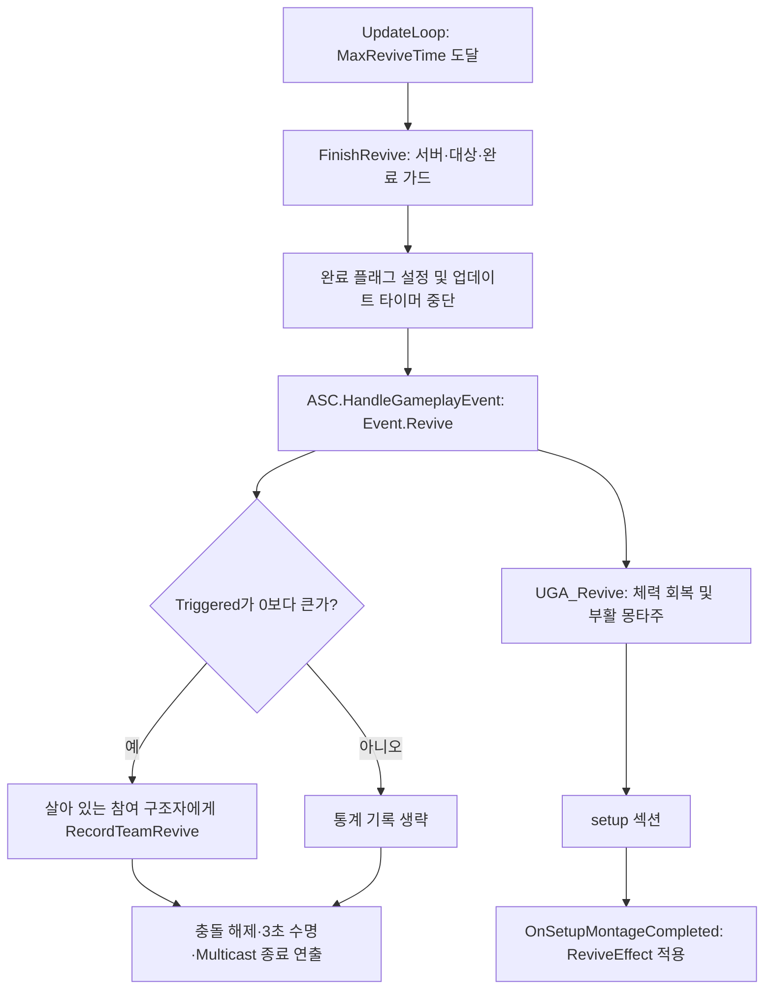

# Issue #15 사망 및 부활 시스템 구현

> Showcase 현행화: 기준 코드 `265059d8a3305a45c8f6c890590f4074069a3a88`에 맞춰 갱신했습니다. 원본 문서의 Git 이력은 `Provenance/WikiHistory.fi`에 별도로 보존합니다.

## 1. Issue
- **Issue 번호**: #15
- **기능명**: 사망 및 부활 시스템 통합 파이프라인 및 상태 시각화 구현
- **담당자**: seok0317
- **담당 영역**: Ability System / Interaction / Blueprint / UI / Material

## 2. 목적
GAS(Gameplay Ability System)를 기반으로 플레이어의 체력이 0이 되었을 때의 사망 처리부터, 팀원의 협동을 통한 장판(Zone) 부활, 그리고 부활 시 부여되는 무적 버프 및 데미지/피격 UI 연출까지의 전체 생명주기를 완벽하게 구현한다.

## 3. 주요 구조
```text
[어트리뷰트 체력 0 도달] 
  ↓ (Event.Death)
UGA_Death (사망 상태 연계, 몽타주 재생)
  ↓ EndAbility에서 FinishDeath 후 서버 장판 스폰
AReviveZoneActor (부활 장판)
 ├─ TSubclassOf<UReviveGaugeWidget> ReviveGaugeClass
 └─ 서버 주도 오버랩 판정 및 15초 게이지 계산
  ↓ (MaxReviveTime 도달 -> FinishRevive -> Event.Revive)
UGA_Revive (체력 회복 -> 부활 몽타주 -> setup -> ReviveEffect 적용)
  ↓ (GameplayCue 발동)
AGC_Invincible (무적 이펙트를 골반 소켓에 강제 부착)

[상시 UI 및 연출]
WBP_GamePlayBase (전투 HUD)
 └─ UDamageOverlayWidget (ASC 체력 바인딩, 체력 저하 및 피격 시 외곽 비네트 연출)
```

## 4. 관련 구현 파일 (C++)
- `Source/TeamProject_Fin/GameCore/Ability/GA_Death.h/.cpp`
- `Source/TeamProject_Fin/GameCore/Ability/GA_Revive.h/.cpp`
- `Source/TeamProject_Fin/GameCore/Ability/Cue/GC_Invincible.h/.cpp`
- `Source/TeamProject_Fin/GameCore/Interact/ReviveZoneActor.h/.cpp`
- `Source/TeamProject_Fin/GameCore/UI/ReviveGaugeWidget.h`
- `Source/TeamProject_Fin/GameCore/UI/DamageOverlayWidget.h/.cpp`

---

## 5. C++ 코어 시스템 세부 구현 내용

### 5.1 사망 흐름 (Death Flow)
- **사망 감지**: `CharacterAttributeSet::PostGameplayEffectExecute`가 피해 적용 후 `CombatDamageEventRouter::RouteDamageExecuted`를 호출한다. 라우터가 사망 전환을 판단하면 `BroadcastDeath`에서 `Event.Death`를 전달해 `UGA_Death`를 실행한다.
- **입력 제어**: `APlayerCharacter::Move` 함수 내부에서 캐릭터가 `State.Dead` 태그를 가지고 있으면 이동을 즉시 차단(Return)한다. 단, 마우스 화면 회전(Look)은 허용하여 누워있는 동안 아군의 전투를 관전할 수 있게 한다.
- **장판 생성**: 현재 `UGA_Death::EndAbility`에서 `Character->FinishDeath()`를 호출한 뒤 서버 권한과 `ReviveZoneClass`를 확인해 장판을 스폰하고 `InitializeZone(Character)`로 연결한다. 사망 몽타주 시작과 동시에 스폰하는 구조가 아니다.

### 5.2 협동 부활 (Revive Zone)
- **서버 주도 검증**: 살아있는 팀원이 반경 300의 캡슐 영역에 오버랩되면 `ActiveRescuers` 배열에 추가된다. 서버의 0.05초 주기 타이머가 `UpdateLoop`를 호출해 유효한 구조자를 검증하고 게이지를 올린다. 액터의 프레임 Tick을 사용하는 구조는 아니다.
- **이탈 시 유예 기간(Grace Period)**: 구조자가 밖으로 나가도 2초간 게이지가 유지되며, 이후 1초당 3초 분량씩 게이지가 빠르게 깎인다(Decaying).
- **UI 최적화 및 캐싱 (ESC 버그 방지)**: 
  - 부활 게이지(`UReviveGaugeWidget`)는 메뉴 창(`UDefaultWidgetLayer`)이 아닌 일반 `UUserWidget`으로 구현한다.
  - 잦은 렉을 방지하기 위해 장판 액터가 단 1회만 `CreateWidget`으로 생성하고, 구조자가 오갈 때 `Visibility(Visible/Collapsed)`만 토글한다.
  - `Destroy()` 파괴 시퀀스 도중 좀비 위젯이 스폰되는 엔진 버그를 막기 위해 `IsActorBeingDestroyed()` 방어 로직을 삽입했다.

### 5.3 부활 성공 및 무적 큐 (Gameplay Cue)
- **완료 진입**: `MaxReviveTime`(기본 15초)에 도달하면 `FinishRevive`를 호출한다. 서버 권한·대상·`!bReviveCompleted`를 확인한 뒤 플래그를 설정하고 서버 업데이트 타이머를 중단한다.
- **이벤트와 통계**: `Event.Revive` 전달의 반환값 `Triggered`가 0보다 크면 완료 순간 참여 중인 유효하고 살아 있는 구조자의 PlayerState에 `RecordTeamRevive`를 호출한다. 이는 이벤트로 어빌리티가 실행됐다는 조건이며 최종 부활 몽타주가 끝났다는 뜻은 아니다.
- **장판 종료**: 충돌을 끄고 `SetLifeSpan(3.0f)`를 설정한다. `Multicast_OnReviveFinished`가 클라이언트 UI·이펙트·타이머·사운드를 정리하고 액터는 설정된 수명 뒤 파괴된다.
- **State 갱신**: `UGA_Revive::ActivateAbility`에서 체력을 먼저 회복한다. 첫 부활 몽타주 후 `setup` 섹션을 재생하고 `OnSetupMontageCompleted`에서 `ReviveEffectClass`를 적용한다. 사망 태그 해제·무적·GameplayCue는 연결된 GameplayEffect 설정에 따른다.
- **기여 구분**: 부활 영역·진행 상태·UI/오디오·복제 및 부활 어빌리티는 본인 구현이다. `FinishRevive`의 완료 가드·서버 타이머 중단·이벤트 실행 확인·구조자 통계 연결은 팀원 `horimi_`가 `db473010`에서 추가했으며, 헤더의 `bReviveCompleted`도 해당 변경이다.

#### 부활 완료 동작 플로우


- **원본 함수 위치**: `GameCore/Interact/ReviveZoneActor.cpp`의 `FinishRevive`·`Multicast_OnReviveFinished`, `GameCore/Ability/GA_Revive.cpp`의 `ActivateAbility`·`OnMontageCompleted`·`OnSetupMontageCompleted`.
- **Showcase 코드**: [ReviveZoneActor 발췌](../../Code/DeathAndRevive/ReviveZoneActor.excerpt.cpp), [GA_Revive.cpp](../../Code/DeathAndRevive/GA_Revive.cpp). 발췌본의 팀원 기능 코드는 임의로 복원하지 않았다.

- **무적 이펙트 강제 부착 (`AGC_Invincible`)**:
  - `AGameplayCueNotify_Actor`를 상속받는 C++ 클래스로 구현.
  - 엔진이 마음대로 캡슐 컴포넌트(발밑)에 이펙트를 부착해버리는 현상을 막기 위해 `bAutoAttachToOwner = false;`로 설정.
  - `WhileActive` 단계에서 Skeletal Mesh의 특정 뼈(`TargetBoneName` = pelvis)를 찾아 강제로 스냅 부착시켜 이펙트가 캐릭터 몸통 중심을 따라다니도록 보장한다.

### 5.4 체력 및 피격 데미지 오버레이 (UI 연출)
- **상시 구조 변경**: 데스 스크린을 폐기하고, 전투 HUD 내부에 부품으로 들어가는 `UDamageOverlayWidget`으로 재설계.
- **실시간 델리게이트 바인딩**: `NativeConstruct` 시점 로컬 플레이어의 `AbilitySystemComponent`에 접근해 `Health` 어트리뷰트 변경 델리게이트를 바인딩하여 Tick 의존도를 제거.
- **다이나믹 머티리얼 연출**: 
  - 체력이 50% 밑으로 떨어질 때부터 외곽에 피가 맺히기 시작하며, 0% 도달 시 시야 전체가 붉게 물든다.
  - 피격 시 델리게이트가 구형 값(Old)과 신형 값(New)을 비교해, 감소했을 때만 `HitFlashAlpha`를 치솟게 하고 C++ `NativeTick`으로 부드럽게 감쇠시킨다.

---

## 6. 블루프린트 및 데이터 에셋 세팅

### 6.1 다이나믹 피격/체력 머티리얼 구성
- `HealthRatio`와 `HitFlashAlpha` 스칼라 파라미터를 기반으로 동작.
- **비선형 외곽 마스크**: `RadialGradientExponential`에 `OneMinus`와 `Power(지수 3~5)` 노드를 거쳐 중앙 시야는 깨끗하게 유지하고 가장자리 쪽에만 마스크를 날카롭게 형성함.

### 6.2 부활 게이지 채도(HSV) 변화 연출
- 부활 게이지 바 비율(0.0~1.0)을 `HSV to RGB` 노드의 채도(Saturation) 값으로 활용하여 하얀색에서 빨간색으로 게이지 색상 실시간 변경.

### 6.3 메타사운드 동기화
- 부활 진행률(VisualProgress)에 비례하여 사운드의 피치(Pitch)와 템포를 점진적으로 상승시키고, 부활 성공 시 클라이맥스 트리거를 전송.

---

## 7. 사용 방법 (에디터 세팅)

1. **부활 장판 세팅**: `BP_ReviveZone` 액터의 디테일 패널 -> `Revive Settings | UI` 카테고리에서 `ReviveGaugeClass`에 `WBP_ReviveGauge` 할당.
2. **큐 에디터 갱신**: 창(Window) -> `GameplayCue Editor`를 열어 `BP_GC_Invincible`을 GAS 시스템이 인식하도록 등록 갱신.
3. **HUD 배치**: 상시 HUD(`WBP_GamePlayBase`) 캔버스에 `WBP_DamageOverlay`를 추가하고, 앵커를 **전체 채우기(Fill)** 로 설정.

---

## 8. 시스템 테스트 및 해결한 트러블슈팅 (Bug Fixes)

### 테스트 내역
아래는 기존 실행 테스트 기록이다. 이번 갱신은 현재 코드 대조이며 새 PIE 실행 검증은 수행하지 않았다.

- [x] 체력 0에서 사망 상태로 전환되고 사망 어빌리티 종료 처리에서 장판이 서버에 스폰되는가?
- [x] 구조자가 장판에 들어갔다 나올 때 부활 게이지가 서버-클라 간 정상 동기화되며, UI 생성 렉이 없는가?
- [x] 부활 성공 시 무적 이펙트가 발밑(캡슐)이 아닌 골반(Pelvis) 위치에 정확히 달라붙는가?
- [x] 데미지를 입거나 체력이 50% 밑으로 떨어졌을 때 화면 가장자리에 피격 오버레이가 정상적으로 노출되는가?

### 해결한 주요 트러블슈팅
1. **파괴 시퀀스 좀비 위젯 버그 (Destruction Sequence Zombie Widget)**
   - **증상**: 부활에 성공하여 호스트 서버의 장판이 파괴될 때, 부활 게이지 위젯이 화면에 영원히 지워지지 않고 남는 현상.
   - **해결 과정 및 현재 구조**: 초기 `Destroy()` 기반 종료에서 `EndPlay` 정리 후 남은 `UpdateLoop`가 UI를 다시 만드는 호출 순서 문제에 대응했다. 현재는 파괴 여부·유효성·타이머 활성 상태 검사와 함께 `FinishRevive`에서 서버 타이머를 중단하고 멀티캐스트로 UI·이펙트·사운드를 정리한 뒤 3초 수명으로 종료한다.
2. **부활 장판 최초 오버랩 무시 버그 (BeginOverlap Issue)**
   - **해결**: 장판 생성 직후(`InitializeZone`) 캡슐에 이미 겹쳐 있는 액터들을 `GetOverlappingActors`로 긁어와 수동으로 `OnOverlapBegin`을 강제 호출해주도록 픽스함.
3. **피격 오버레이 전체 화면 붉어짐 버그 (Material Math Logic)**
   - **해결**: 머티리얼 내에서 마스크 연산이 모두 끝난 최종 단계에 `HitFlashAlpha`를 단순 더하기(Add) 하던 로직을 수정. 베이스 투명도에 먼저 더한 뒤 그라데이션 마스크(Radial Mask)를 곱하도록 순서를 변경하여 테두리 쪽에만 피격 효과가 먹히도록 수학 수식 수정.
4. **무적 이펙트 발밑 스폰 버그 (GameplayCue Auto-Attach)**
   - **해결**: `AGameplayCueNotify_Actor`의 기본 설정인 `bAutoAttachToOwner`를 `false`로 끄고, C++ `WhileActive` 단계에서 스켈레탈 메시의 `pelvis`(골반) 소켓을 찾아 수동으로 스냅 부착(Snap to Target)하도록 강제함.

---

## 9. 남은 작업 또는 확장 방향
- **힐 오버레이 추가**: 향후 회복 틱마다 오버레이 머티리얼에 초록색 플래시 파라미터를 추가 전송하여 피드백 강화.
- **데스 스크린 애니메이션**: 체력 0 도달 시 WBP_DamageOverlay 내에서 "You Died" 텍스트 페이드인 위젯 애니메이션 연동.
