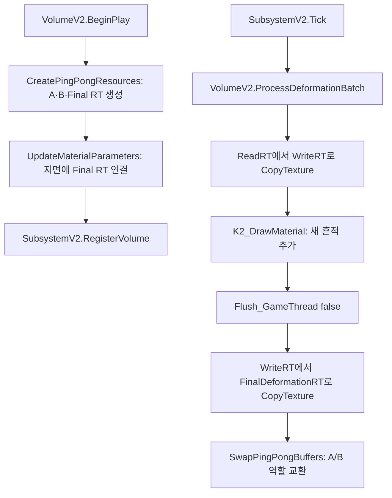

# Issue #46 동적 스노우 디포메이션(Snow Deformation) 시스템 개발 및 최적화

> Showcase 현행화: 기준 코드 `265059d8a3305a45c8f6c890590f4074069a3a88`에 맞춰 갱신했습니다. 원본 문서의 Git 이력은 `Provenance/WikiHistory.fi`에 별도로 보존합니다.

## 1. Issue
- **Issue 번호**: #46
- **기능명**: 실시간 동적 눈 변형 시스템 구축 및 성능 최적화
- **담당자**: seok0317
- **담당 영역**: Rendering / C++ Subsystem / Material / Network Optimization / Ability System(Blueprint)

## 2. 개요 및 기능 구현 이유 (Motivation)
- **목적**: 최신 고품질 게임의 환경 상호작용에 대한 시각적 피드백을 구현하기 위해 눈 변형 시스템을 도입합니다. 캐릭터의 발자국이 눈을 쓸고 지나가는 물리적 흔적을 실시간으로 묘사하여 게임 플레이 몰입도를 극대화합니다.
- **기본 아키텍처**: 눈 변형의 기본 렌더링 구조는 `지면 Raycast -> Render Target 갱신 -> World Position Offset(WPO) 셰이더 변형` 파이프라인으로 구성됩니다. 이와 연동되어 극한의 환경을 표현하는 다단계 눈보라 디버프(Gameplay Effect) 시스템이 함께 구동됩니다.

## 3. 시스템 논리 구조 및 상세 구현 방법
현재 C++ 런타임은 V2 기준이다. V1 전용 Subsystem의 렌더링 함수와 현재 SubsystemV2의 볼륨 관리 역할을 구분한다. 초기 셰이더 설계 예시와 개발 중 문제 기록은 유지한다.


### 3.1 볼륨별 핑퐁 RT와 최종 출력 RT
- **목적**: 이전 흔적을 보존하며 새 발자국을 누적하고, 계산용 버퍼 교환과 지면에 제공하는 텍스처 참조를 분리한다.
- **책임 분리**:
  - `ASnowDeformationVolumeV2`: `SnowHeightRT_A/B`·`FinalDeformationRT`·브러시/지면 MID·`PendingPayloads`를 소유한다.
  - `USnowDeformationSubsystemV2`: 볼륨 등록·해제와 `Tick`의 배치 호출을 담당한다. V1처럼 전역 RT 쌍을 소유하는 역할은 아니다.
  - `USnowDeformationComponentV2`: 추적 소켓과 Trace 결과로 Payload를 만들고 적중 볼륨에 전달한다.
- **처리 순서**: ReadRT를 WriteRT로 복사하고 새 Payload를 추가한다. Flush 후 WriteRT 결과를 고정 출력인 `FinalDeformationRT`로 복사하는 명령을 넣은 다음 A/B의 읽기·쓰기 역할을 교환한다. 지면 MID는 `FinalDeformationRT`를 참조한다.

#### 동작 플로우 및 함수 명세


- **`CreatePingPongResources` / `UpdateMaterialParameters` (`SnowDeformationVolumeV2.cpp`)**: 볼륨별 RT와 MID를 준비하고 최종 출력 RT를 지면에 연결한다.
- **`RegisterVolume` / `Tick` (`SnowDeformationSubsystemV2.cpp`)**: 등록된 볼륨을 관리하고 각 볼륨의 `ProcessDeformationBatch`를 호출한다.
- **`RegisterDeformationPayload` / `ProcessDeformationBatch` (`SnowDeformationVolumeV2.cpp`)**: Payload를 모으고 월드 위치를 UV로 변환해 그린다. Payload가 없고 풍화도 꺼져 있으면 배치를 생략한다.
- **`SwapPingPongBuffers` (`SnowDeformationVolumeV2.h`)**: 불리언으로 A/B의 읽기·쓰기 역할을 교환한다. 이때 지면 머티리얼 참조를 다른 RT로 교체하지 않는다.
- **Showcase 코드**: [SnowDeformationVolumeV2.cpp](../../Code/SnowDeformation/SnowDeformationVolumeV2.cpp), [SnowDeformationSubsystemV2.cpp](../../Code/SnowDeformation/SnowDeformationSubsystemV2.cpp).

### 3.2 발바닥 정밀 침투 물리 및 M_SnowBrush (Custom HLSL)
- **왜 이런 기능이 필요했나**: 공중에 떠 있을 때는 눈이 파이지 않아야 하며, 캐릭터의 이동 방향에 맞춰 타원형 발자국이 찍혀야 합니다. 또한 단순히 깎이는 것이 아니라 질량 보존 법칙에 의해 발자국 가장자리로 눈이 밀려 올라가는 둑(Mound)이 사실적으로 표현되어야 합니다.
- **논리 구조 및 사용 방법**: 
  - 현재 `USnowDeformationComponentV2::ProcessContinuousSweeps`는 소켓 궤적을 샘플링하고 Trace 적중 액터를 눈 볼륨으로 확인합니다. 발-접점 높이 차이가 -15cm 이상일 때 기본 깊이 0.5에 침투 깊이·속도·소켓 배율을 반영하고 해당 볼륨에 Payload를 직접 등록합니다. V1의 `SubmergedDepth > 0` 검사와 구분합니다.
  - 렌더 타깃에 도장을 찍는 브러시 머티리얼(`M_SnowBrush`)은 텍스처가 아닌 **Custom HLSL 코드**를 통해 수학적으로 계산됩니다.
  - 코사인(cos) 종 모양 공식을 통해 완만하게 솟아오르는 둔덕을 셰이더 내부에서 실시간으로 산출합니다.

```glsl
// M_SnowBrush 내 Custom 노드 발자국 생성 HLSL 
float2 p = uv - float2(0.5, 0.5);
float2 p_oval = float2(p.x * 0.85, p.y * 1.15); // 진행 방향 타원형 조절
float r = length(p_oval) * 2.0;
float holeProfile = 0.0;
float moundProfile = 0.0;

if (r < 0.5) { // 파이는 중심부
    float t = r / 0.5;
    holeProfile = 0.5 * (1.0 + cos(t * 3.141592));
} else if (r < 1.0) { // 밀려 올라가는 가장자리 둔덕(Mound)
    float t = (r - 0.5) / 0.5;
    moundProfile = 0.5 * (1.0 - cos(t * 3.141592 * 2.0)); 
}
// 이후 질량 보존 및 이전 프레임 깊이(OldDepth)와 블렌딩 적용
```

### 3.3 M_SnowGround (지형 셰이더) 및 M_SnowErosion (풍화 복원 셰이더)
- **M_SnowErosion (눈 덮임 시뮬레이션)**: Unlit Surface 머티리얼로 제작되었으며, 매 프레임 이전 렌더 타깃의 깊이 값에서 `ErosionRate` 파라미터 수치만큼 지속적으로 빼기(Subtract) 연산을 수행해 파였던 발자국 구덩이가 다시 눈에 덮여 서서히 메워지는 효과를 구현합니다.
- **M_SnowGround (최종 렌더링 및 디테일링)**:
  - **WPO (버텍스 변형)**: RT 값을 한계치 내로 Clamp한 뒤, World Position 기반의 Noise 함수를 더해 인위적이지 않은 유기적인 바람결 굴곡을 형성하고 버텍스를 Z축으로 강하시킵니다.
  - **Base Color & Roughness & Normal**: RT 깊이 값이 파여있을수록 러프니스를 높이고(0.9), 조금 더 어두운 텍스처(0.8 Tint)와 다른 노멀 맵으로 보간(Lerp)하여, 발로 밟아 단단하고 얼어붙은 눈 바닥의 질감을 사실적으로 묘사합니다.
  - **Opacity (Radial Gradient Mask)**: 눈 볼륨 밖으로 벗어날 때 디포메이션 효과가 뚝 끊기지 않도록, UV 중심부로부터의 거리를 계산하여 경계를 부드럽게 페이드 아웃(EdgeSoftness) 처리하는 방사형 마스크를 적용했습니다.

### 3.4 블루프린트 게임플레이 이펙트 (Snow Hazard & Debuff GE)
- 환경 변화를 체감할 수 있도록 다단계 디버프를 Ability System으로 관리합니다.
- **GE_SnowDebuff_Lv1~2**: 눈보라 지대 진입 시 틱당 스태미나 소모 배율(StaminaCostMultiplier)을 증가시키고, 이동 속도(MovementSpeed) 및 재장전 속도(ReloadMontageRateMultiplier)를 떨어뜨립니다.
- **GE_SnowDebuff_Lv3**: 극한 구역 진입 시 발동되며, Tag(State.Movement.Sprinting) 기반으로 **달리기 스킬을 원천 차단(Block/Cancel)**합니다. 동시에 `GE_SnowDebuff_Tick`을 주입합니다.
- **GE_SnowDebuff_Tick (0.1초 주기)**: 최대 체력 배율(HealthCapMultiplier)과 최대 스태미나 배율(StaminaCapMultiplier)을 초당 지속적으로 깎아먹어 UI 상 체력/스태미나가 얼어붙는 치명적 상태를 연출합니다.
- **GE_SnowRegen_Tick**: 눈보라 구역을 벗어났을 때 부여되어, 깎였던 최대 체력/스태미나 캡(Cap)을 초당 0.03씩 다시 재생(회복)시킵니다.

## 4. 초기 설계의 한계점과 치명적 이슈 (Problems)

### 4.1 연산 오버헤드 (CPU/GPU 병목)
- **문제**: 연속된 흔적(Continuous Interaction)을 남기기 위해 매 프레임 지면 Raycast와 렌더 타겟 텍스처 드로우 연산을 수행하게 되면 프레임 드랍 등 성능이 급격히 저하되는 병목 현상이 발생했습니다.

### 4.2 멀티플레이어 대역폭 초과
- **문제**: 지형 파임 상태(픽셀 텍스처 데이터)를 서버가 직접 계산하여 모든 클라이언트에게 실시간 동기화하려 시도했으나, 초당 주고받아야 하는 네트워크 대역폭이 한계를 초과하여 서버가 버티지 못하는 상황이 발생했습니다.

### 4.3 Additive(가산) 블렌딩 무한 누적 문제 (지형 찢어짐 현상)
- **문제**: 렌더 타겟에 깊이 값(Brush)을 그릴 때 단순 가산(Additive) 방식으로 텍스처를 더하게 되면, 플레이어가 제자리에 서서 발을 구르거나 여러 명이 같은 궤적을 지나갈 때 눈이 파이는 깊이가 임계치를 넘어 무한히 누적됩니다. 이는 눈 지형이 바닥 메쉬를 뚫고 들어가거나 버텍스가 기괴하게 찢어지는(Tearing) 치명적인 시각적 버그를 유발했습니다.

### 4.4 렌더 타깃 초기화, 공중 디포메이션, 인위적 노이즈 패턴
- **문제**: 엔진 내부의 ClearColor 렌더링 동작에 의해 발자국 데이터가 매 프레임 소실되었고, 발목 높이 단순 연산으로 인해 공중에서도 뚱뚱한 원기둥 모양의 눈파임 현상이 발생했습니다. 또한 셰이더 후단 Clamp 처리로 발자국 바닥이 완전히 평면이 되고 인위적인 빨래판 무늬가 생겼습니다.

## 5. 최종 해결 방안 및 최적화 아키텍처 (Troubleshooting Solutions)

### 5.1 연산 최적화: Distance Threshold 및 Physical Material 필터링
- **해결 방안 (Distance Threshold)**: 무조건 매 프레임 궤적 연산을 수행하지 않습니다. 이전 위치와 현재 위치의 차이(Delta Distance)가 일정 임계값(Threshold) 이상 발생했을 때만 드로우 연산을 수행하여 불필요한 연산 호출 빈도를 대폭 줄였습니다.
- **해결 방안 (현행 대상 검증)**: `ProcessContinuousSweeps`는 Trace 적중 액터가 `ASnowDeformationVolumeV2`인지와 발-접점 높이를 확인합니다. Physical Material 정보를 요청하지만 해당 함수에서 SurfaceType이나 RVT 레이어 ID를 직접 비교하는 구조는 아닙니다.

### 5.2 네트워크 최적화: Client-side Rendering 분리
- **해결 방안**: 멀티플레이 시 눈 변형 상태를 서버에서 전혀 계산/동기화하지 않습니다. 서버는 캐릭터와 몬스터의 위치(Transform) 데이터만 기존처럼 클라이언트에 전송하고, 각 클라이언트의 GPU가 개별적으로 화면 내 액터들의 위치를 기반으로 렌더 타겟 브러시를 스스로 그리도록 처리했습니다. 이를 통해 스노우 디포메이션과 관련된 네트워크 대역폭 소모를 0으로 만들었습니다.

### 5.3 셰이더 및 C++ 파이프라인 리팩토링 (무한 누적 및 렌더 오류 방지)
- **가산 무한 누적(지형 찢어짐) 해결**: 셰이더 내부 로직 연산 순서를 완전히 역전시켜, RT 텍스처 추출 직후에 가장 먼저 Clamp 연산을 걸어 기준 깊이를 락킹(Locking)했습니다. 아무리 많은 발자국이 제자리에서 중첩(Additive)되어도 기획된 최대 깊이(SnowDepth)를 절대 뚫고 나가지 못하도록 차단하여 버텍스 찢어짐을 완벽히 해결했습니다.
- **현행 C++ 파이프라인**: 볼륨이 A/B RT에 흔적을 누적하고 결과를 `FinalDeformationRT`로 복사합니다. 접지는 Trace의 실제 눈 표면과 소켓 높이 차이로 확인하며 -15cm 허용 범위·기본 깊이·속도·소켓 배율을 사용합니다. 초기 V1의 -10cm 오프셋·`SubmergedDepth` 설명을 현재 코드의 조건으로 사용하지 않습니다.
