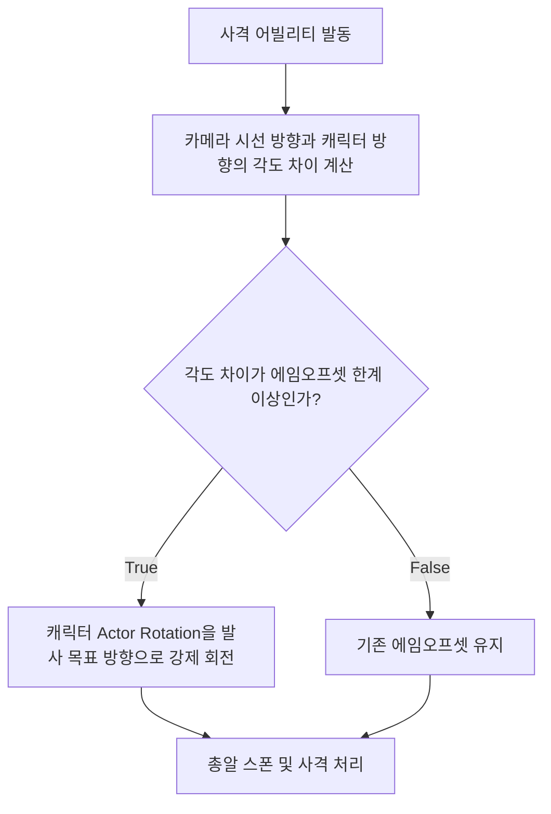
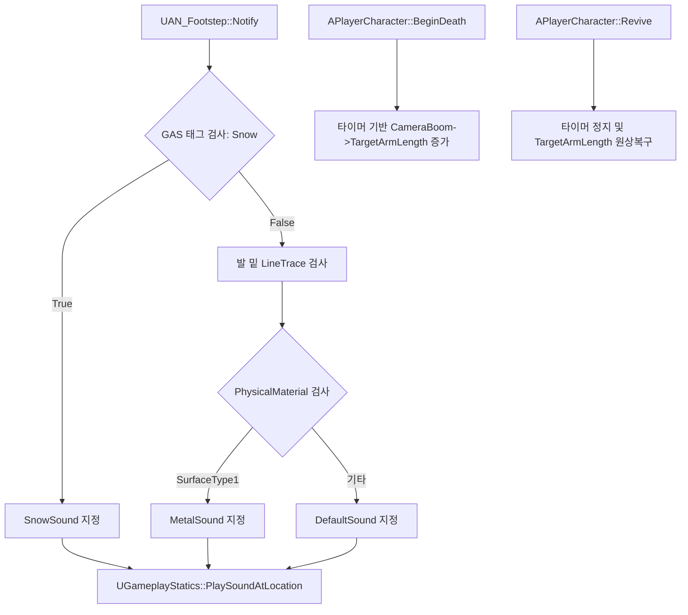
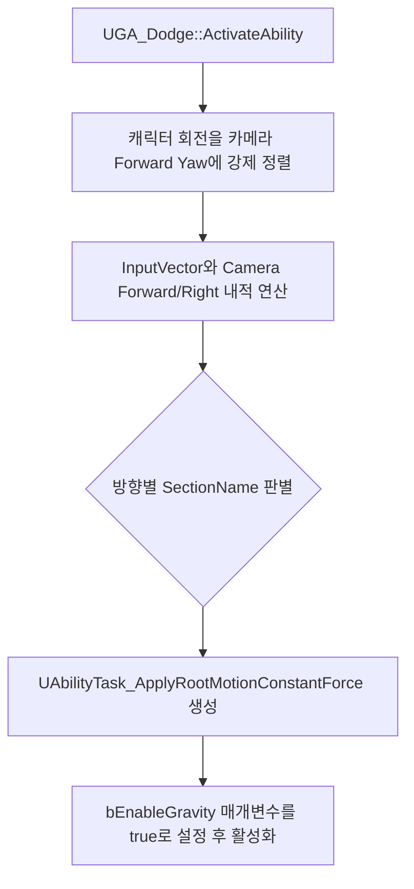
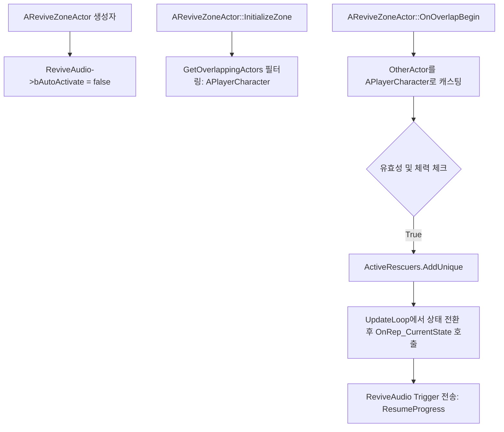
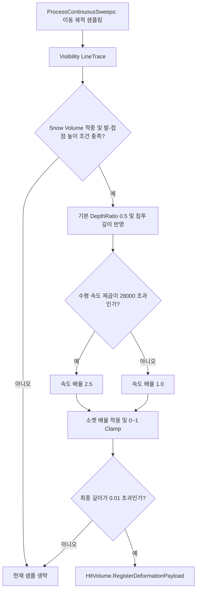

# 기술문서: 에임오프셋, 사운드 시스템 및 구르기/부활 버그 수정

> Showcase 현행화: 기준 코드 `265059d8a3305a45c8f6c890590f4074069a3a88`에 맞춰 갱신했습니다. 원본 문서의 Git 이력은 `Provenance/WikiHistory.fi`에 별도로 보존합니다.

## 1. Issue
- **Issue 번호**: #74
- **기능명**: 에임오프셋 구조 개선, 시스템 사운드 추가 및 구르기/부활 액터 로직 버그 수정
- **담당자**: seok0317
- **담당 영역**: Character System / Animation System / Interact System / Ability System

## 2. 에임오프셋 초과 사격 시 캐릭터 회전 기능 구현

### 1.1 개요
오프셋이 작동하는 각도 한계 이상으로 화면을 꺾고 총을 발사할 경우, 총알이 모델링 상의 총구 방향과 다르게 부자연스럽게 꺾여 나가는 현상을 방지하기 위해 로직을 추가하였습니다. 발사 시 목표 방향이 에임오프셋 한계를 넘어서면, 캐릭터의 몸(Actor Rotation) 자체를 발사 방향으로 즉각 회전시켜 발사 궤적을 일치시킵니다.

### 1.2 동작 플로우 및 함수 명세

- **파일 경로**: GameCore/Ability/GA_Fire.cpp (또는 관련 사격 처리부)
- **기능 및 역할**: 플레이어가 발사 조작을 할 때, 현재 카메라가 바라보는 각도가 캐릭터 에임오프셋이 커버할 수 있는 한계 범위를 초과했는지 판별합니다. 초과 상태에서 사격 시 총구에서 총알이 비정상적으로 꺾이는 것을 막기 위해, 사격 직전 캐릭터 몸통 회전축(Yaw)을 카메라 시선 방향에 맞춰 정렬(SetActorRotation)함으로써 자연스러운 사격 모션과 총알 궤적을 보장합니다.

---

## 3. 사운드 시스템 추가 및 AN_Footstep 노티파이 구현

### 3.1 개요
캐릭터의 발소리를 지형 재질과 환경 상태에 따라 동적으로 재생하기 위해 커스텀 애니메이션 노티파이(AN_Footstep)를 구현하였습니다. 또한 부활 장판 생성 및 사망 연출에 필요한 로직을 추가하였습니다.

### 3.2 동작 플로우 및 함수 명세

- **파일 경로**: GameCore/Animation/AN_Footstep.cpp
- **UAN_Footstep::Notify**
  - **기능 및 역할**: 애니메이션 시퀀스에서 발이 땅에 닿을 때 호출됩니다. 첫째로 어빌리티 시스템 컴포넌트(ASC)를 통해 State.Environment.Snow 태그를 보유하고 있는지 검사하여 눈 밟는 소리를 최우선 할당합니다. 둘째로 태그가 없다면 발 소켓 위치에서 아래로 LineTrace를 쏴 바닥의 PhysicalMaterial을 읽어 금속(SurfaceType1)인지 확인합니다. 최종 판별된 사운드를 PlaySoundAtLocation으로 재생하여 지형 상호작용 피드백을 제공합니다.

- **파일 경로**: GameCore/Character/PlayerCharacter.cpp
- **APlayerCharacter::BeginDeath / Revive**
  - **기능 및 역할**: 로컬 플레이어의 BeginDeath에서 0.016초 주기 타이머로 스프링암 길이를 300.0f까지 보간(FInterpTo)합니다. Revive에서는 타이머를 해제하고 길이를 140.0f로 즉시 복구합니다.
---

## 4. 구르기 버그 수정

### 3.1 개요
구르기 시 캐릭터의 시선 방향과 애니메이션 이동 방향(루트모션)이 불일치하는 현상(문워크 현상)을 수정하였으며, 구르기 도중 공중에 체공할 때 중력이 적용되지 않는 문제를 해결하였습니다.

### 3.2 동작 플로우 및 함수 명세

- **파일 경로**: GameCore/Ability/GA_Dodge.cpp
- **UGA_Dodge::ActivateAbility**
  - **기능 및 역할**: 구르기 어빌리티 발동 시 가장 먼저 캐릭터의 회전(Yaw)을 카메라가 바라보는 방향과 동일하게 강제 정렬합니다. 이를 통해 루트모션의 기준 좌표계와 애니메이션 몽타주의 방향을 일치시킵니다. 또한 ApplyRootMotionConstantForce 함수 호출부의 마지막 인자(bEnableGravity)를 true로 활성화하여 구르기 도중 지형 높낮이에 맞춰 중력이 정상적으로 적용되도록 수정하였습니다.

---

## 5. 부활 게이지 사운드 버그 수정

### 4.1 개요
플레이어가 죽은 뒤 부활 액터(장판)가 스폰될 때 사운드가 자동으로 재생되거나, 몬스터가 장판을 밟았을 때 부활 게이지가 차오르며 사운드가 출력되는 심각한 오작동을 수정하였습니다.

### 4.2 동작 플로우 및 함수 명세

- **파일 경로**: GameCore/Interact/ReviveZoneActor.cpp
- **AReviveZoneActor::AReviveZoneActor (생성자)**
  - **기능 및 역할**: ReviveAudio 컴포넌트의 bAutoActivate 속성을 false로 지정하여, 스폰 시 언리얼 엔진 기본 설정에 의해 의도치 않은 사운드가 강제 재생되는 현상을 원천 차단합니다.

- **AReviveZoneActor::InitializeZone**
  - **기능 및 역할**: 액터 스폰 직후 반경 내에 이미 들어와 있는 액터를 수동으로 검사할 때, 쿼리 필터를 ABaseCharacter에서 APlayerCharacter로 변경하여 엔진 차원의 충돌 검색 최적화를 이루었습니다.

- **AReviveZoneActor::OnOverlapBegin / OnOverlapEnd**
  - **기능 및 역할**: 장판에 오버랩된 OtherActor를 APlayerCharacter로 명시적 캐스팅합니다. 이를 통해 BaseCharacter를 상속받는 몬스터나 적대적 AI가 장판을 밟더라도 부활 로직 및 사운드(ActiveRescuers 배열 추가)가 절대 동작하지 않도록 예외 처리 로직을 강화하였습니다.

---

## 6. 블루프린트 연동 (사운드 시스템 및 애니메이션 노티파이)

### 6.1 개요
C++에서 구현한 커스텀 발소리 로직(AN_Footstep)과 부활 장판의 상태 전환 트리거를 블루프린트 및 오디오 에셋에 연동합니다. 애니메이션 시퀀스와 몽타주에 알맞은 사운드 노티파이를 배치하고, 메타사운드의 입력 핀을 분리하여 자동 재생 버그를 방지하며, 사운드 감쇠(Attenuation) 설정을 통해 멀티플레이 환경에 최적화된 오디오 파이프라인을 구축합니다.

### 6.2 메타사운드(MetaSound) 커스텀 트리거 연동
부활 장판 생성 및 상태 전환 시 오작동하는 사운드 버그를 해결하기 위해 메타사운드 그래프를 수정하였습니다.
- **자동 재생 방지**: Wave Player 노드의 Play 핀에 기본적으로 연결되는 On Play 입력을 제거(Disconnect)하여 의도치 않은 사운드 강제 재생 현상을 차단했습니다.
- **상태별 트리거 맵핑**: C++ 코드 내부에서 상태가 전환될 때마다 전달하는 커스텀 트리거 파라미터를 메타사운드의 Input 노드로 받도록 구성했습니다.
  - PlaySuccess: 부활 100% 완료 시 트리거되어 부활 성공 사운드 및 이펙트를 출력합니다.
  - ResumeProgress: 부활 게이지 상승(Reviving) 진입 시 트리거되어 게이지 사운드를 재생합니다.
  - StopProgress: 플레이어가 밖으로 이탈하여 GracePeriod나 Decaying 진입 시 트리거되어 게이지 사운드를 중지(Stop)시킵니다.

### 6.3 애니메이션 몽타주 및 시퀀스 사운드 노티파이 적용
C++에서 작성된 커스텀 노티파이(AN_Footstep)와 기본 사운드 노티파이를 기반으로 각 액션에 맞는 사운드를 애니메이션 타임라인에 정밀하게 배치했습니다.
- **피격 사운드** : 피격 몽타주(AM_HitReact)의 각 방향 섹션 초입에 Scifi_Hit4 노티파이를 배치하여 타격 효과음을 적용했습니다.
- **발소리** : 걷기/달리기 애니메이션 시퀀스(MM_Rifle_Walk_Fwd 등)에서 캐릭터의 발이 바닥에 닿는 정확한 프레임에 맞춰 AN_Footstep 노티파이를 반복 배치했습니다.
- **구르기 사운드** : 구르기 몽타주의 전, 후, 좌, 우 각 섹션이 시작되는 순간에 DodgeJump_wav 노티파이를 삽입하여 회피 액션 피드백을 제공합니다.
- **사망 사운드** : 사망 몽타주(AM_PlayerDeath)가 시작될 때 Scifi_Dead 노티파이를 호출하여, 스프링암 길이를 부드럽게 증가시켜 시야를 확보하는 카메라 연출(BeginDeath)과 함께 사망 효과음이 재생되도록 구성했습니다.

### 6.4 사운드 감쇠(Attenuation) 공간화 세팅
타 플레이어의 행동 사운드가 월드 전역에 동일한 크기로 들리지 않도록 SA_Footstep 등의 사운드 어테뉴에이션(Attenuation) 에셋 디테일을 설정하였습니다. 
- **볼륨 어테뉴에이션 활성화**: 거리에 따른 선형(Linear) 감쇠를 구(Sphere) 형태로 적용했습니다.
- **거리 설정**: 사운드가 원본 크기로 들리는 내부 반경(Inner Radius)을 400.0으로, 소리가 완전히 사라지는 감쇠 거리(Falloff Distance)를 3600.0으로 지정하여 멀티플레이어 환경의 거리감을 물리적으로 구현했습니다.
- **공간화(Spatialization) 활성화**: Panning 메서드를 사용하여 소리의 좌우 방향성(3D 스테레오 사운드)을 확보했습니다.

### 6.5 테스트 또는 확인 내용
- **로컬 사운드 및 감쇠 검증**: PIE 멀티플레이어 환경 테스트 시, 로컬 조종 플레이어의 조건(IsLocallyControlled)이 참일 때 거리에 상관없이 선명하게 들리는 2D 사운드가 정상 출력되는지 검증 완료. 타 플레이어의 사운드는 감쇠 거리 세팅(3600.0)에 맞게 거리에 비례하여 줄어드는지 확인 완료.
- **예외 처리 동기화**: BaseCharacter를 상속받는 몬스터나 적대적 AI가 부활 장판을 밟더라도 부활 로직 및 사운드가 절대 동작하지 않는 C++ 예외 처리 로직이 블루프린트 환경에서도 완벽히 적용됨을 확인 완료.
- **메타사운드 트리거 검증**: 부활 게이지 진행 및 이탈 시 C++ 코드 내부에서 상태가 전환될 때마다 ResumeProgress와 StopProgress 파라미터 신호가 즉시 전송되어 사운드 오차가 발생하지 않는지 확인 완료.

---

## 7. 달리기 시 눈 지형(Snow Deformation) 깊이 누락 트러블슈팅

### 7.1 개요
초기 V1에서는 발이 눈 메쉬 아래로 충분히 들어가지 않으면 기초 침투 비율이 0에 가까워져, 속도 배율을 높여도 눈이 얕게 파이는 문제가 있었습니다. 현재 V2의 `USnowDeformationComponentV2::ProcessContinuousSweeps`는 실제 Trace 접점과 소켓 높이를 비교하고, 기본 깊이에 속도·소켓별 배율을 적용합니다.

### 7.2 문제 원인 및 현재 해결 방법
- **초기 문제**: V1의 `SubmergedDepth` 기반 기초 비율이 작으면 달리기 배율을 곱해도 깊이가 충분히 증가하지 않았습니다.
- **대상 검증**: 궤적의 샘플 위치에서 Trace하고, 적중 액터가 `ASnowDeformationVolumeV2`인지 확인합니다. `DistanceFromFootToGround = HitResult.Location.Z - SamplePos.Z`가 -15.0f보다 작으면 발자국을 기록하지 않습니다.
- **기본 깊이**: 유효한 접점에는 `DepthRatio = 0.5f`를 부여합니다. 발이 표면보다 아래에 있으면 `0.5f + DistanceFromFootToGround / 20.0f`를 0.5~1.0으로 제한합니다. 현재 V2는 V1의 `BaseRatio >= 0.8` 규칙을 사용하지 않습니다.
- **배율**: `Velocity.SizeSquared2D()`가 28000.0f를 초과하면 속도 배율을 2.5f로, 그 외에는 1.0f로 설정합니다. 여기에 `Socket.DepthMultiplier`를 곱하고 최종 깊이를 0~1로 제한합니다.
- **기록**: 최종 깊이가 0.01f 이하이면 생략하고, 나머지는 `Payload.DepthIntensity`에 저장해 적중 볼륨의 `RegisterDeformationPayload`에 직접 전달합니다.

### 7.3 동작 플로우 및 함수 명세

- **원본 파일 경로**: `Source/TeamProject_Fin/snowdeformation_V2/SnowDeformationComponentV2.cpp`
- **`ProcessContinuousSweeps`**: 샘플링·Trace·접점 검증·깊이 계산·Payload 전달을 담당합니다.
- **`ASnowDeformationVolumeV2::RegisterDeformationPayload`**: 볼륨의 `PendingPayloads`에 기록합니다. SubsystemV2의 `Tick`이 각 볼륨의 `ProcessDeformationBatch`를 호출하면 RT에 반영됩니다.
- **Showcase 코드**: [SnowDeformationComponentV2.cpp](../../Code/SnowDeformation/SnowDeformationComponentV2.cpp), [SnowDeformationVolumeV2.cpp](../../Code/SnowDeformation/SnowDeformationVolumeV2.cpp)
