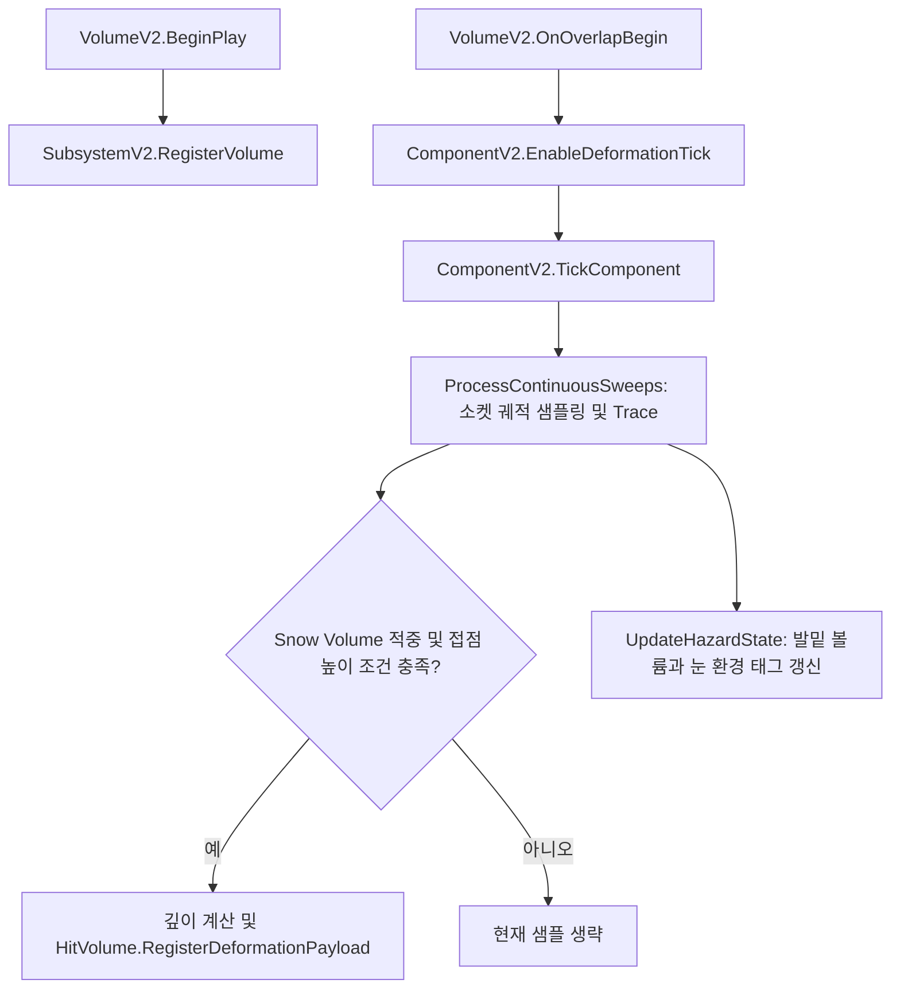
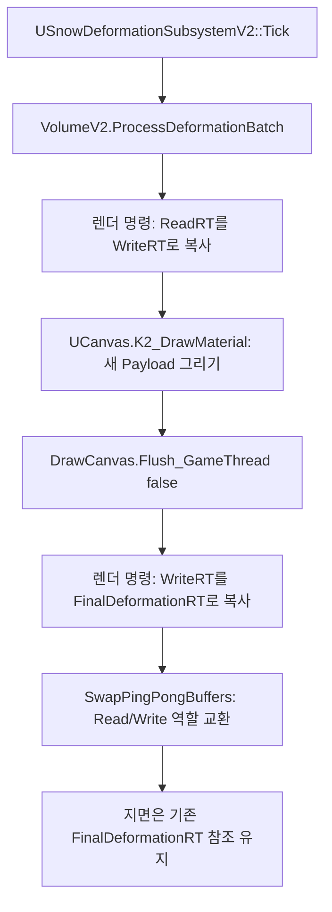
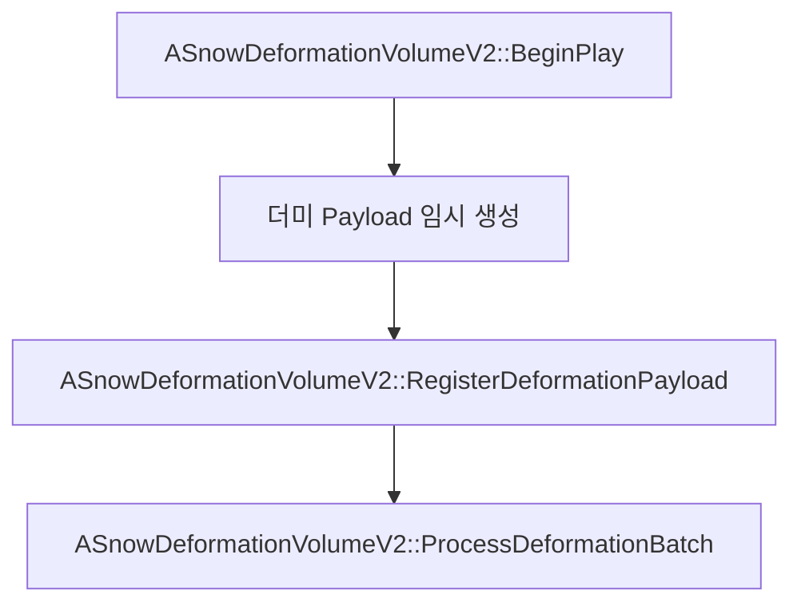

# Issue #90 Snow Deformation V2 (눈 변형 시스템 업그레이드)

> Showcase 현행화: 기준 코드 `265059d8a3305a45c8f6c890590f4074069a3a88`에 맞춰 갱신했습니다. 원본 문서의 Git 이력은 `Provenance/WikiHistory.fi`에 별도로 보존합니다.

## 1. Issue
- **Issue 번호**: #90
- **기능명**: Snow Deformation V2 (눈 파임 시스템 고도화 및 최적화)
- **담당자**: seok0317
- **담당 영역**: Environment / Rendering / Collision / Optimization

## 2. 목적
기존 눈 변형 시스템(V1)에서 발생하던 심각한 프레임 하락(렌더 스레드 병목)과 나나이트 테셀레이션의 성능 한계를 극복하고, 라인트레이스를 통한 정밀한 발자국 물리 연산을 구현하여 고품질/고효율의 눈밭 상호작용 아키텍처를 구축한다.

## 3. 주요 구조
- **라인트레이스 감지 구조**: 오버랩은 컴포넌트 Tick 활성화에 사용합니다. 실제 발자국은 소켓 궤적의 샘플 위치에서 Trace한 뒤, 적중 액터가 `ASnowDeformationVolumeV2`인지와 발-접점 높이를 검사합니다. 현재 해당 함수는 `SurfaceType2` 값을 직접 비교하지 않습니다.
- **틱(Tick) 토글 및 캐싱 구조**: 볼륨(BoundsBox) 진입 시에만 연산 틱을 활성화하고, 이탈 시 캐시된 위치 데이터와 디버프 태그를 날려버리는 무동력 최적화 구조.
- **렌더타겟 핑퐁 비동기 구조**: `ProcessDeformationBatch`에서 UCanvas 명령을 모아 실행하되, `Flush_GameThread(false)`를 통해 GPU 렌더링을 비동기로 위임하는 병렬 처리 구조.

## 4. 관련 구현 파일
- **C++ Classes**:
  - `SnowDeformationVolumeV2.h / .cpp`: 렌더타겟 핑퐁 메모리 소유, 비동기 렌더링 배치 처리, 바운드 박스 오버랩 감지, 워밍업 스폰.
  - `SnowDeformationComponentV2.h / .cpp`: 캐릭터 소켓의 궤적 샘플링·Trace·깊이 계산·Payload 전달·눈 환경 태그 갱신·Tick 전환 담당.
  - `SnowDeformationSubsystemV2.h / .cpp`: 볼륨 등록·해제, 등록 볼륨의 배치 호출, 위치 기반 Payload 전달 및 눈 표면 조회 담당. 눈 환경 태그는 ComponentV2의 `UpdateHazardState`에서 변경.
- **Data / Materials**:
  - `DefaultEngine.ini`: 물리 머티리얼 속성 추가 (`SurfaceType2 = Snow`).
  - `M_SnowBrush_V2`: 발자국 렌더타겟 브러시 머티리얼.
  - `M_Snow_Displacement`: 나나이트 테셀레이션 파임 효과 및 원거리 렌더링 감쇠(PixelDepth) 셰이더.

## 5. 주요 구현 내용 및 시스템 역할

### 5.1 상호작용 감지 및 틱(Tick) 제어 파이프라인
볼륨 등록은 `BeginPlay`에서 수행합니다. 오버랩으로 컴포넌트 Tick이 활성화되면 `TickComponent`에서 연속 궤적 생성 후 환경 태그를 갱신합니다.

#### 동작 플로우 및 함수 명세

- **`ASnowDeformationVolumeV2::BeginPlay` (`SnowDeformationVolumeV2.cpp`)**: RT·머티리얼 준비 후 `SubsystemV2::RegisterVolume(this)`로 볼륨을 등록합니다. 발자국마다 볼륨을 다시 등록하지 않습니다.
- **`ASnowDeformationVolumeV2::OnOverlapBegin` (`SnowDeformationVolumeV2.cpp`)**: 겹친 액터의 눈 변형 컴포넌트에 Tick 활성화를 요청합니다.
- **`USnowDeformationComponentV2::EnableDeformationTick` (`SnowDeformationComponentV2.cpp`)**: 진입/이탈 여부에 따라 틱 연산 강제 토글 (잉여 비용 0% 달성).
- **`USnowDeformationComponentV2::ProcessContinuousSweeps` (`SnowDeformationComponentV2.cpp`)**: 소켓 궤적을 샘플링하고 Trace합니다. 눈 볼륨 적중과 높이 조건을 통과한 Payload를 해당 볼륨에 직접 등록합니다.
- **`USnowDeformationComponentV2::UpdateHazardState` (`SnowDeformationComponentV2.cpp`)**: 액터 아래로 Trace해 눈 볼륨을 찾고, 이전·현재 볼륨 단계에 따라 ASC의 눈 환경 태그를 제거·추가합니다.
- **다른 입력 API**: `TriggerFootstep`도 Trace 후 적중 볼륨에 직접 등록합니다. `ApplyDeformationAtLocation`은 위치를 받아 SubsystemV2를 경유합니다. 현재 `UAN_Footstep::Notify`의 C++ 코드는 발소리·VFX를 처리하며 눈 변형 Payload를 등록하는 코드는 제거되어 있습니다.

### 5.2 비동기 렌더링 및 핑퐁 복사 파이프라인
SubsystemV2에 등록된 각 볼륨이 자체 PendingPayloads와 RT를 처리합니다. 계산용 Read/Write RT와 지면에 제공하는 FinalDeformationRT를 분리합니다.

#### 동작 플로우 및 함수 명세

- **`USnowDeformationSubsystemV2::Tick` (`SnowDeformationSubsystemV2.cpp`)**: 렌더링 배치 업데이트 일괄 호출.
- **`ASnowDeformationVolumeV2::ProcessDeformationBatch` (`SnowDeformationVolumeV2.cpp`)**: ReadRT를 WriteRT로 복사한 뒤 Payload를 UV로 변환해 그립니다. Flush 후 WriteRT를 FinalDeformationRT로 복사하는 명령을 넣고 A/B 역할을 교환합니다. 지면 머티리얼 참조를 매 배치마다 교체하지 않습니다.
- **`Canvas::Flush_GameThread` (엔진 코어)**: `false`를 통해 GPU 비동기 위임 (게임 스레드 Block 방지).
- **`ENQUEUE_RENDER_COMMAND` (엔진 코어 매크로)**: 게임 스레드(캐릭터 로직 및 연산)와 렌더 스레드(VRAM 제어 및 렌더링)의 역할을 엄격히 분리합니다. 게임 스레드가 계산한 발자국 연산 결과와 렌더 타겟 주소를 캡슐화하여 렌더 스레드의 큐(Queue)에 안전하게 전달함으로써, 메인 스레드 크래시 없이 비동기 렌더링이 이루어지게 합니다.

### 5.3 렌더 스레드 워밍업 파이프라인
최초 눈밭 진입 시 GPU 셰이더 초기화 지연(Hitch)을 막는 플로우입니다.

#### 동작 플로우 및 함수 명세

- **`ASnowDeformationVolumeV2::BeginPlay` (`SnowDeformationVolumeV2.cpp`)**: 생성 시 눈에 안 보이는 더미 발자국을 즉시 그려서 GPU 캐싱 사전 완료.

## 6. 트러블슈팅 및 픽스 내역

### 트러블슈팅 1: 오버랩 기반 감지의 허공 발자국 오류
- **문제**: 기존 V1은 박스에 오버랩만 되면 허공에서 뛰어도 발자국이 남는 치명적 물리 오류 발생.
- **해결**: 오버랩은 Tick 활성화에 사용합니다. 연속 궤적에서는 적중 액터를 `ASnowDeformationVolumeV2`로 확인하고 접점과 샘플 높이 차이가 -15.0f 미만이면 제외합니다. Physical Material 정보를 요청하지만 현재 해당 함수는 `SurfaceType2`를 직접 비교하지 않습니다.

### 트러블슈팅 2: 메쉬 자동 맞춤 기능의 한계와 UV 왜곡
- **문제**: 볼륨을 직사각형으로 길게 늘릴 시 메쉬 스케일 왜곡으로 인해 발자국 렌더타겟이 타원형으로 찌그러지는 부작용 발생.
- **해결**: 복잡한 UV 픽스 오버엔지니어링 대신 기존 비례 공식을 살림. 맵 배치 시 크기 보정을 위해 메쉬 크기 자동화 플래그(`bAutoFitBoundsToMesh`)를 꺼서 수동 오버라이드할 수 있도록 유연성 부여.

### 트러블슈팅 3: 동기화 락(Lock)에 의한 프레임 폭락
- **문제**: 발자국이 찍힐 때마다 프레임이 10단위로 폭락하는 치명적 렉 발생.
- **해결**: `DrawCanvas.Flush_GameThread(true)`가 게임 스레드를 Block 시키고 있었음을 파악하여 `false` 파라미터(비동기 렌더링)로 교체해 프레임 완전 회복.

### 트러블슈팅 4: 첫 렌더링 초기화 지연 (Hitch)
- **문제**: 첫 발자국이 찍힐 찰나에만 미세한 렉이 발생.
- **해결**: `BeginPlay` 에서 초소형 가짜 발자국을 즉시 한 바퀴 그려내어 GPU 셰이더와 메모리 할당을 로딩 단계에서 사전 캐싱시키는 워밍업(Warm-up) 도입.

### 트러블슈팅 5: 나나이트 테셀레이션 광역 GPU 과부하
- **문제**: 화면 전체 눈밭을 픽셀 단위로 쪼개느라 막대한 GPU 오버헤드 발생.
- **해결**: 머티리얼 내부에 `PixelDepth`와 `SmoothStep`을 활용, 카메라 반경 15m 내외만 파임 연산을 적용하고 멀어지면 상수값으로 보간하여 나나이트 연산 대거 스킵. (역방향 입력에 따른 원거리 증발 에러는 `OneMinus`를 통해 해결함).

## 7. 사용 방법
1. **레벨 배치**: 에디터에 `BP_SnowDeformationVolumeV2`를 배치.
2. **크기 조절**: `BoundsBox`를 늘려 영역 세팅 (기본: 메쉬 자동 스케일). 비율 조정이 필요하면 `bAutoFitBoundsToMesh`를 끄고 수동 세팅.
3. **충돌 설정**: 눈 볼륨 메쉬가 `Visibility` Trace로 검출되도록 설정합니다. 연속 궤적은 적중 액터가 `ASnowDeformationVolumeV2`가 아니면 생략하므로, 바위 등 다른 액터에 먼저 적중하면 발자국을 기록하지 않습니다.

## 8. 테스트 또는 확인 내용
- **물리 검증**: 눈밭 위에 올려진 바위(Default PM)로 점프 착지 시, 눈자국 렌더링이 되지 않는 현상 디버깅 완료.
- **비동기 퍼포먼스**: 볼륨 내 다중 캐릭터가 움직일 때 메인 게임 스레드 드랍 현상 없이 부드러운 프레임 60+ 방어 확인 완료.
- **셰이더 지연 검증**: 첫 진입 시 프레임 스파이크 발생률 0% 테스트 완료.

## 9. 남은 작업 또는 확장 방향
- **VHM 확장**: 맵 크기가 수 킬로미터 이상의 오픈월드로 확장될 경우, 볼륨마다 RT를 개별 소유하는 현재 시스템을 버리고 단일 RVT 기반 Virtual Heightfield Mesh로 렌더링 플랫폼 전환 고려.
