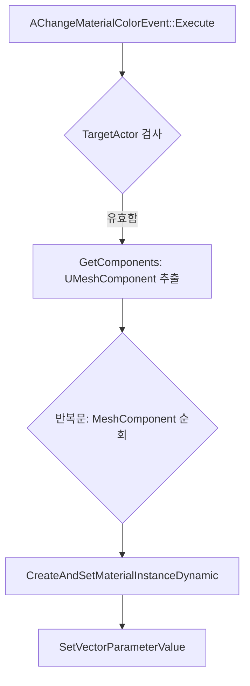

# Issue #94 혹한 맵 제작 및 머티리얼 색상 변경 이벤트 추가

## 1. Issue
- **Issue 번호**: #94
- **기능명**: 혹한 맵 지형 제작 및 머티리얼 색상 변경 이벤트 연동
- **담당자**: seok0317
- **담당 영역**: Level Design / Map Build / Blueprint / Material

## 2. 목적
자연스러운 눈 덮인 지형과 눈보라 연출을 통해 혹한 맵의 시각적 퀄리티를 향상시키고, 게임 플레이 중 구역 해제의 직관성을 높이기 위해 런타임에 액터의 머티리얼 색상을 동적으로 변경할 수 있는 **이벤트 파이프라인**을 구축한다.
- **레벨 디자인 파트**: 디폼(Deform) 버텍스 스컬프팅과 나이아가라(Niagara) 시스템을 활용해 고해상도의 눈보라 지형을 구성하며, `BP_OverlapBattleSector`를 활용해 전투 흐름에 따라 환경을 동적으로 제어한다.
- **이벤트(C++) 파트**: 블루프린트 단에서 대상 액터의 머티리얼 속성을 쉽게 조작할 수 있도록 `AChangeMaterialColorEvent`를 도입하여, 원본 훼손 없이 런타임에 다이내믹 머티리얼 인스턴스(MID)를 생성 및 교체하는 단일화된 구조를 정립한다.

## 3. 주요 구조
```text
혹한 맵 제어 시스템 (블루프린트 & 레벨)
 ├─ 지형 구성: 16개로 분할된 스태틱 메쉬에 스컬프팅 및 SnowDeformation 적용
 ├─ 파티클 연출: Niagara (SpriteBurst, Shape Location, Curl Noise Force)로 눈보라 구현
 └─ 전투 섹터 (BP_OverlapBattleSector)
     ├─ 타겟 액터: 적 몬스터, 눈보라 파티클, 차단벽 제어
     └─ 포스트 이벤트 (Post Events) 발동
         └─ AChangeMaterialColorEvent (단일 색상 변경 진입점)
             ├─ TargetActor의 하위 UMeshComponent 일괄 추출
             ├─ CreateAndSetMaterialInstanceDynamic 호출로 MID 동적 캐싱
             └─ SetVectorParameterValue를 통한 런타임 색상 오버라이드
```

## 4. 관련 구현 파일
- `Source/TeamProject_Fin/PCGMap/MapBuild/SectorBuild/Event/PlacedEvent/ChangeMaterialColorEvent.h`
- `Source/TeamProject_Fin/PCGMap/MapBuild/SectorBuild/Event/PlacedEvent/ChangeMaterialColorEvent.cpp`

---

## 5. 세부 구현 내용

### 5.1 혹한 맵 지형 제작 및 눈보라 연출
- **스컬프팅 및 지형 최적화**: 모델링 모드를 사용해 Plane을 확장하고 리메시를 통해 버텍스를 나눈 뒤, 버텍스 스컬프팅과 플래튼으로 맵 지형을 평탄화 및 구성했습니다. 높은 해상도의 머티리얼 적용을 위해 지형을 16개의 스태틱 메쉬로 분할했습니다.
- **SnowDeformation 적용**: 눈이 배치될 구역만 병합해 시스템 메쉬로 구성하였으며, 부자연스러운 마감은 버텍스 스컬프팅으로 자연스럽게 연결했습니다.
- **Niagara 눈보라 구현**: `SpriteBurst` 프리셋을 기반으로 `Shape Location`과 `Add Velocity` 노드로 눈보라의 퍼짐과 속도를 구현하고, `Curl Noise Force`로 불규칙한 난기류 움직임을 추가했습니다.

### 5.2 머티리얼 색상 변경 이벤트 (`ChangeMaterialColorEvent`)
기믹 해제 및 상호작용 피드백을 위해 레벨에 배치된 특정 액터의 색상을 동적으로 변경합니다. `AScenePlacedEvent`를 상속받아 배틀 섹터 클리어 시 등 조건에 맞춰 이벤트를 발동시킬 수 있습니다.

#### 동작 플로우 및 함수 명세

- **`Execute`** (`ChangeMaterialColorEvent.cpp`): 상호작용이나 배틀 섹터(`BP_OverlapBattleSector`) 등 외부 트리거에 의해 호출되어 이벤트를 시작합니다.
- **`GetComponents` (내부 로직)** (`ChangeMaterialColorEvent.cpp`): 타겟으로 지정된 액터 내부의 모든 `UMeshComponent`(스태틱 메쉬, 스켈레탈 메쉬 등)를 탐색하여 배열로 추출합니다.
- **`CreateAndSetMaterialInstanceDynamic`** (엔진 내장 `MeshComponent.h`): 대상 컴포넌트의 머티리얼을 런타임에 파라미터 조작이 가능한 다이내믹 머티리얼 인스턴스(MID)로 복제 및 교체합니다. 이를 통해 원본 에셋의 변형 없이 개별 액터의 색상만 변경할 수 있습니다.
- **`SetVectorParameterValue`** (엔진 내장 `MaterialInstanceDynamic.h`): 복제된 머티리얼 인스턴스의 특정 파라미터(예: "Color")에 새로운 색상(`FLinearColor`) 값을 적용합니다.

---

## 6. 트러블슈팅

### 6.1 지형 병합 및 해상도 저하 이슈
- **문제점**: SnowDeformation 적용을 위해 넓은 범위의 지형을 하나의 메쉬로 병합했을 때, 머티리얼 UV 해상도가 깨지고 경계선 마감이 부자연스러워지는 현상이 발생했습니다.
- **해결 방법**: 통짜 병합을 취소하고 지형을 16개의 독립된 메쉬로 분할 적용하여 UV 밀도를 확보했습니다. 눈이 덮이는 필수 구역만 재병합해 처리한 뒤, 버텍스 스컬프팅으로 외곽선을 다듬어 곡면 처리를 부드럽게 해결했습니다.

---

## 7. 테스트 및 확인 내용
- [x] 섹터에 설정된 적을 모두 처치했을 시 모든 Event가 정상 작동하는가
- [x] SnowDeformationVolume이 문제없이 인식되는가
- [x] 다음 노드로 넘어갈 수 있는가
